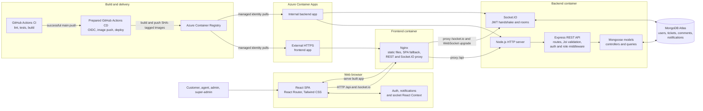
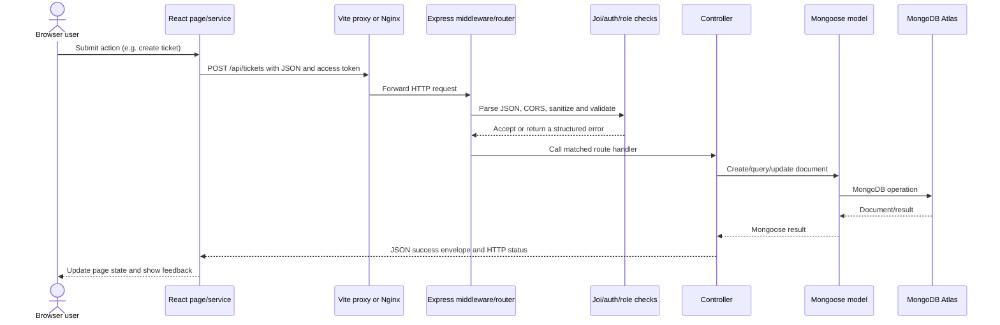
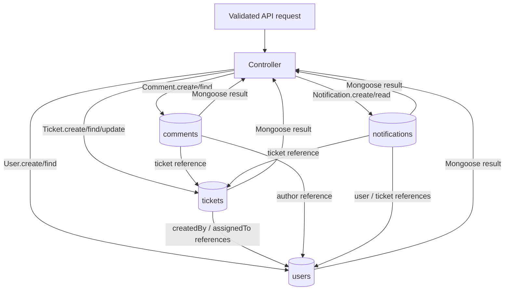
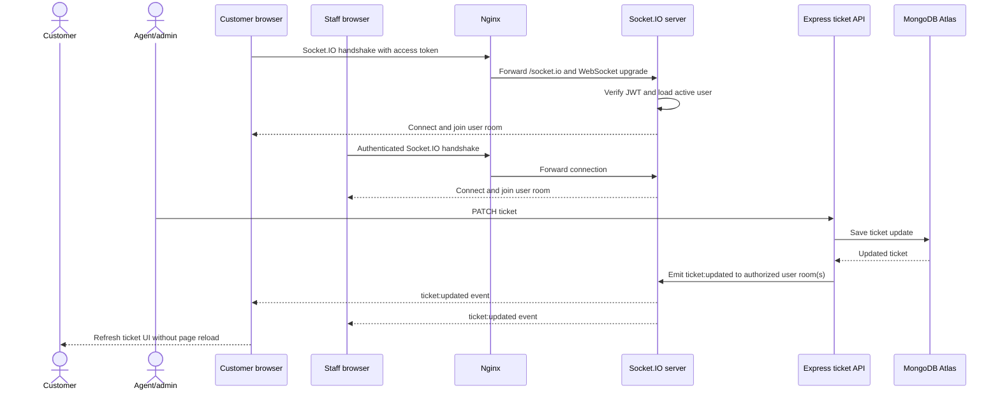
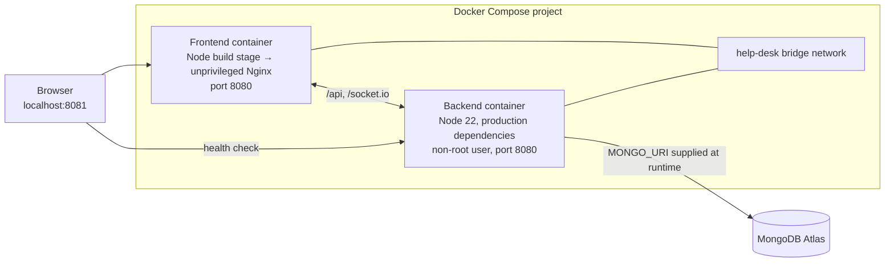
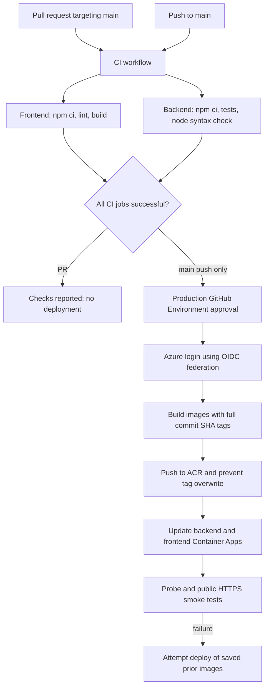
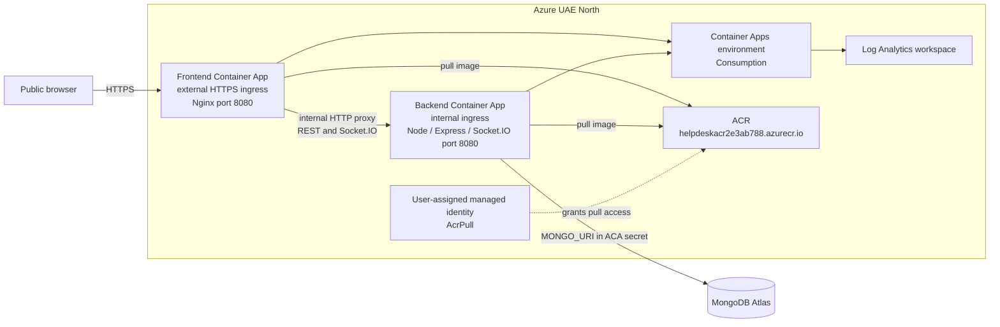

# Help Desk Ticketing System — College Evaluation Guide

This guide explains the project at a third-year Information Technology engineering level. It is both a technical overview and a step-by-step demonstration plan. Diagrams use Mermaid; GitHub renders Mermaid diagrams in Markdown.

> **Evaluation safety:** Use a development or evaluation database for demonstrations. The demo seeder creates accounts and sample tickets in the database identified by `MONGO_URI`. Do not show passwords, access tokens, refresh-cookie contents, private database URIs, or Azure secrets on screen.

## 1. Project at a glance

Help Desk is a full-stack support-ticket application. Customers submit and track tickets; agents work on assigned tickets; admins oversee and assign tickets; super-admins manage staff. The frontend is a React SPA styled with Tailwind CSS. Its REST requests and authenticated Socket.IO connection go through an Nginx reverse proxy in Docker and Azure. Express validates and authorizes requests, Mongoose reads and writes MongoDB Atlas documents, and Socket.IO sends live events to authorized clients.

### Complete architecture



In local development, Vite proxies `/api` and `/socket.io` to Express instead of Nginx. In Docker and Azure, Nginx is the public same-origin entry point, which also lets the browser use the HTTP-only refresh cookie without exposing a backend URL in frontend code.

## 2. Technology and implementation guide

### 2.1 Frontend with Tailwind CSS

- **Technology:** React, Vite, Tailwind CSS 4, React Router.
- **Why:** React builds the interface from reusable components; Tailwind utility classes make styling consistent and quick to adjust; Vite provides the development server and production bundler; React Router provides client-side pages.
- **Where:** [`client/src/index.css`](../client/src/index.css), [`client/vite.config.js`](../client/vite.config.js), [`client/src/pages/`](../client/src/pages/), [`client/src/components/`](../client/src/components/), and [`client/src/routes/AppRoutes.jsx`](../client/src/routes/AppRoutes.jsx).
- **How:** Vite loads the React and Tailwind plugins. The main CSS imports Tailwind and the project token/base styles. React Router maps URLs to public, authentication, customer, agent, admin, and super-admin pages. Production Nginx serves the compiled `dist` files and returns `index.html` for a frontend route that is not a physical file.
- **Demonstrate:** Open the landing page and identify the navigation, typography, spacing, badges, cards, and responsive layout. Navigate to Register, then a role dashboard. Refresh a deep link such as `/customer/dashboard`; it should return the SPA.
- **Faculty may ask:** “Why Tailwind rather than writing all CSS manually?”
  - **Suggested answer:** “Tailwind provides small utility classes directly in the component markup. That helps keep styling consistent and makes responsive changes quick. Global tokens and base rules still live in CSS.”
- **Faculty may ask:** “What does Vite do?”
  - **Suggested answer:** “Vite serves the frontend during development and bundles/minifies the React application into static production files.”

### 2.2 React and state management

- **Technology:** React function components, `useState`, `useEffect`, custom hooks, and the React Context API.
- **Why:** Shared state such as the signed-in user and notifications must be available to many pages. Context shares it without passing props through every intermediate component; local form and list state stays in component/hook state.
- **Where:** [`client/src/main.jsx`](../client/src/main.jsx), [`client/src/context/AuthContext.jsx`](../client/src/context/AuthContext.jsx), [`client/src/context/NotificationContext.jsx`](../client/src/context/NotificationContext.jsx), [`client/src/context/SocketContext.jsx`](../client/src/context/SocketContext.jsx), and [`client/src/hooks/`](../client/src/hooks/).
- **How:** `main.jsx` wraps the application in the router and context providers. The auth provider exposes the current user, loading state, and login/register/logout operations. Ticket hooks manage loading/data/error state for ticket pages. The notification and socket providers share live state and connection status.
- **Demonstrate:** Sign in, open the customer dashboard, then show that the navigation and page content reflect the signed-in role. Open the notification indicator and show state changing after an event.
- **Faculty may ask:** “Are you using Redux?”
  - **Suggested answer:** “No. The project uses React Context for cross-page state and hooks such as `useState` for local state. Redux was not needed for this project’s current scope.”
- **Faculty may ask:** “Where is the access token stored?”
  - **Suggested answer:** “The access token is kept in application memory. A non-secret local-storage marker tells the app to attempt session restoration; the refresh token itself is an HTTP-only cookie and is not readable by JavaScript.”

### 2.3 Backend REST API

- **Technology:** Node.js, Express, JSON over HTTP, modular routes/controllers/middleware.
- **Why:** HTTP methods and status codes provide a clear interface between the browser and server. Controllers keep request handling separate from route declarations and database models.
- **Where:** [`server/server.js`](../server/server.js), [`server/src/app.js`](../server/src/app.js), [`server/src/routes/`](../server/src/routes/), [`server/src/controller/`](../server/src/controller/), and [`server/docs/API_CONTRACT.md`](../server/docs/API_CONTRACT.md).
- **How:** Express receives a request, applies security/CORS/body parsing middleware, routes it to a controller, validates input and authentication, performs database work, and returns a JSON response. A success response has `success`, `message`, and `data`; errors go through the global error middleware. The API health route is `GET /api/health`.
- **Useful example endpoints:** `POST /api/user/register`, `POST /api/user/login`, `GET /api/user/me`, `POST /api/tickets`, `GET /api/tickets/my-ticket`, `PATCH /api/tickets/:id`, `POST /api/tickets/:ticketId/comments`.
- **Demonstrate:** Open browser DevTools → Network, create a ticket, and identify the request method, `/api/tickets` path, status `201`, and JSON response. Do not display request authorization headers or cookie values.
- **Faculty may ask:** “Why use REST?”
  - **Suggested answer:** “REST uses standard HTTP methods and status codes, so the frontend and backend can evolve independently and the API can be tested using a browser, curl, or an API client.”
- **Faculty may ask:** “What does status 201 mean?”
  - **Suggested answer:** “The server successfully created a resource, such as a new ticket.”

### 2.4 MongoDB and Mongoose

- **Technology:** MongoDB Atlas and Mongoose.
- **Why:** MongoDB stores ticketing data as flexible documents. Mongoose gives the Node application schemas, validation constraints, references, timestamps, and a consistent way to query that data.
- **Where:** [`server/src/config/DBConnection.js`](../server/src/config/DBConnection.js), [`server/src/models/`](../server/src/models/), and controllers under [`server/src/controller/`](../server/src/controller/).
- **How:** The backend reads `MONGO_URI` from its environment and connects before it begins listening. Mongoose models represent users, tickets, comments, and notifications. ObjectId references connect tickets to their creator/assignee and comments/notifications to their related records. Controllers create and update documents through these models.
- **Demonstrate:** Create a ticket through the UI, then show the corresponding evaluation record in the ticket list or an authorized Atlas view. Avoid exposing Atlas credentials or unrelated personal data.
- **Faculty may ask:** “Why MongoDB instead of a relational database?”
  - **Suggested answer:** “Ticket records are document-shaped and MongoDB stores nested/flexible data naturally. This application uses ObjectId references to connect related documents.”
- **Faculty may ask:** “Does MongoDB enforce all input rules?”
  - **Suggested answer:** “The API validates requests before database operations. Mongoose also defines model-level constraints, but API-level validation provides user-friendly errors and protects the server boundary.”

### 2.5 Data validation

- **Technology:** Joi for HTTP request schemas, with Mongoose model constraints and a NoSQL-injection middleware as additional safeguards.
- **Why:** Client-side validation improves usability, but a client can be bypassed. The server must validate every untrusted request before it reaches database logic.
- **Where:** [`server/src/utils/Schema.Validation.js`](../server/src/utils/Schema.Validation.js), [`server/src/middlewares/noSqlInjection.Middleware.js`](../server/src/middlewares/noSqlInjection.Middleware.js), and the relevant controllers.
- **How:** Joi checks required fields, types, lengths, allowed enum values, and unknown keys. Examples include password complexity, ticket title/description/category limits, priority and status values, and valid assignment IDs. Invalid data receives a structured `400` response.
- **Demonstrate:** Attempt to submit a ticket with an empty title or an invalid priority. Show the validation message and that the request is rejected. Then submit valid data.
- **Faculty may ask:** “Why validate on the backend if the form already validates?”
  - **Suggested answer:** “Browser checks can be skipped or altered. Server validation is authoritative because requests can come from any client.”
- **Faculty may ask:** “What is NoSQL injection?”
  - **Suggested answer:** “It is an attempt to alter a MongoDB query using crafted input, for example Mongo operator objects. The app rejects unsafe operator-style input and validates allowed fields.”

### 2.6 Authentication and authorization

- **Technology:** JWT access tokens, HTTP-only refresh cookies, Argon2 password hashing, authentication middleware, and role-based authorization.
- **Why:** Authentication answers “who is the user?”; authorization answers “what may that user do?” A short-lived access token supports API calls, while a protected refresh cookie can obtain a new access token.
- **Where:** [`server/src/controller/User.Controller.js`](../server/src/controller/User.Controller.js), [`server/src/utils/utils.functions.js`](../server/src/utils/utils.functions.js), [`server/src/middlewares/auth.Middleware.js`](../server/src/middlewares/auth.Middleware.js), [`server/src/middlewares/role.Middleware.js`](../server/src/middlewares/role.Middleware.js), and [`client/src/lib/api.js`](../client/src/lib/api.js).
- **How:** Registration is public and creates a customer account; it does not accept a client-selected staff role. Passwords are hashed with Argon2. Login returns an access token and sets a refresh token as an HTTP-only cookie. Protected APIs check the bearer access token and load the user's current active role. Refresh rotates the cookie token and stores only a hash server-side. Role middleware limits ticket and staff actions.
- **Role examples:** Customer sees own tickets; agent works on assigned tickets; admin oversees/assigns tickets; super-admin manages staff and customers.
- **Demonstrate:** Sign in with a seeded evaluation account, show the role-specific dashboard, then try opening a route not allowed for that role. It should redirect or return a forbidden response. In DevTools, show only that the cookie is marked HttpOnly/Secure/SameSite as appropriate; never reveal its value.
- **Faculty may ask:** “Why use an HTTP-only cookie?”
  - **Suggested answer:** “JavaScript cannot read an HTTP-only cookie, which reduces exposure if frontend script injection occurs. The browser sends it to the refresh endpoint when credentials are included.”
- **Faculty may ask:** “What is the difference between authentication and authorization?”
  - **Suggested answer:** “Authentication verifies identity. Authorization checks permissions for that identity, such as whether an agent may update a particular assigned ticket.”

### 2.7 Real-time features with Socket.IO

- **Technology:** Socket.IO client in React and Socket.IO server attached to the backend HTTP server.
- **Why:** Polling REST endpoints repeatedly is inefficient for immediate updates. A persistent connection lets the server notify connected clients when a ticket or comment changes.
- **Where:** [`client/src/context/SocketContext.jsx`](../client/src/context/SocketContext.jsx), [`client/src/hooks/useSocket.js`](../client/src/hooks/useSocket.js), [`server/src/realtime/socket.js`](../server/src/realtime/socket.js), and ticket/comment controllers.
- **How:** An authenticated browser opens a socket using its access token. The server verifies the token, checks the current user, and joins a per-user room. Ticket-specific room joins are checked against ticket ownership/assignment. Controllers save an update and then emit events such as `ticket:created`, `ticket:updated`, or `comment:created`. Nginx forwards WebSocket upgrade requests.
- **Demonstrate:** Open the same evaluation ticket in two authenticated sessions (for example, two browser profiles). Update it from the agent or admin session and show the other session receiving the event without refreshing.
- **Faculty may ask:** “How is a Socket.IO client authenticated?”
  - **Suggested answer:** “The client sends its access token during the Socket.IO handshake. The server verifies it and checks the account's current active role before joining user-specific rooms.”
- **Faculty may ask:** “What is a current scaling limitation?”
  - **Suggested answer:** “The current Socket.IO room state is in memory and there is no shared adapter. The deployed backend is limited to one replica; scaling it horizontally would require a shared adapter such as Redis and appropriate session/connection design.”

### 2.8 Docker

- **Technology:** Dockerfiles, Docker Compose, a Node.js runtime, Nginx, and a shared bridge network.
- **Why:** Containers package each service and its runtime dependencies consistently. Compose starts the local services together and provides internal service-name networking.
- **Where:** [`server/dockerfile`](../server/dockerfile), [`client/dockerfile`](../client/dockerfile), [`docker-compose.yml`](../docker-compose.yml), and each service's `.dockerignore`.
- **How:** The backend image installs locked production dependencies, runs as a non-root `node` user, and listens on port `8080`. The frontend Dockerfile builds the Vite app in a Node stage and serves its output from unprivileged Nginx. Nginx routes `/api/` and `/socket.io/` to the backend, supports WebSocket headers/timeouts, and falls back to `index.html` for React Router paths. Compose waits for the backend health check before starting the frontend.
- **Security detail:** `.env`, `node_modules`, build output, and other unnecessary files are excluded from image contexts. Runtime environment values are not copied into an image. Compose uses MongoDB Atlas; it does not start a MongoDB container.
- **Demonstrate:** Run `docker compose ps` and show both services and their health. Open `http://localhost:8081` and `http://localhost:8080/api/health`.
- **Faculty may ask:** “What is the difference between an image and a container?”
  - **Suggested answer:** “An image is the packaged template. A container is a running instance created from that image.”
- **Faculty may ask:** “Why have separate frontend and backend containers?”
  - **Suggested answer:** “They have different runtimes and responsibilities. They can be built, restarted, and scaled independently while communicating on a private network.”

### 2.9 DevOps, CI/CD, and Azure deployment

- **Technology:** GitHub Actions, Docker Buildx, Azure Container Registry (ACR), GitHub OIDC, Azure Container Apps (ACA), and a managed identity for image pulls.
- **Why:** CI checks code before integration. CD can build immutable release artifacts and deploy a verified commit without storing a long-lived Azure password in GitHub.
- **Where:** [`\.github\workflows\ci.yml`](../.github/workflows/ci.yml), [`\.github\workflows\deploy.yml`](../.github/workflows/deploy.yml), and the container definitions above.
- **How — CI now:** On pushes to `main` and pull requests targeting `main`, GitHub Actions checks out the code, uses Node.js 22, runs `npm ci`, lints/builds the frontend, and runs backend tests and a syntax check.
- **How — prepared CD:** The local `deploy.yml` is designed to start only after successful CI for a push to `main`. It checks out that exact commit, builds and pushes full-commit-SHA image tags to ACR, uses OIDC for Azure authentication, updates both Container Apps, verifies health, and attempts to restore prior images if rollout checks fail.
- **Current limitation:** The deployment workflow is present in the local worktree but has not been committed/pushed or run in GitHub Actions. Azure OIDC registration/credentials and GitHub repository variables/environment approval must be configured before this becomes an active, verified CD pipeline.
- **Demonstrate:** In GitHub, open **Actions → CI** and show the successful run linked below. Do not describe the unrun deployment workflow as a successful Actions deployment.
- **Faculty may ask:** “What is CI?”
  - **Suggested answer:** “Continuous Integration automatically runs repeatable checks on changes, so errors are detected before code is accepted.”
- **Faculty may ask:** “What is CD?”
  - **Suggested answer:** “Continuous Delivery/Deployment automates producing and releasing a verified build. In this project the deployment workflow is prepared, but it still needs GitHub/Azure OIDC configuration and an Actions run.”
- **Faculty may ask:** “Why OIDC instead of storing an Azure client secret?”
  - **Suggested answer:** “OIDC exchanges a short-lived GitHub identity token for Azure access. It avoids keeping a long-lived Azure credential in repository secrets.”

## 3. REST API request flow



## 4. Authentication flow

```mermaid
sequenceDiagram
    actor User
    participant Browser as React browser
    participant API as Express auth routes
    participant DB as MongoDB

    User->>Browser: Submit email and password
    Browser->>API: POST /api/user/login
    API->>DB: Find user and read password hash
    DB-->>API: User record
    API->>API: Verify Argon2 password; create access and refresh tokens
    API->>DB: Store hash of refresh token
    API-->>Browser: Access token in JSON; refresh token in HttpOnly cookie
    Browser->>Browser: Keep access token in memory
    Browser->>API: Protected request with bearer access token
    API->>DB: Check active account and current role
    API-->>Browser: Authorized data or 401/403
    Browser->>API: POST /api/user/refresh with cookie when needed
    API->>DB: Verify refresh-token hash, rotate it
    API-->>Browser: New access token and rotated HttpOnly cookie
```

## 5. MongoDB data flow and records



The primary models are `User`, `Ticket`, `Comment`, and `Notification`. Mongoose ObjectId references connect related records. MongoDB Atlas is the database used by the cloud deployment; Docker Compose does not create a local MongoDB service.

## 6. Socket.IO real-time communication



## 7. Docker architecture



The host ports in Compose are bound to loopback: frontend `127.0.0.1:8081` and backend `127.0.0.1:8080`. Only the frontend is needed for normal browser use because Nginx proxies backend routes.

## 8. GitHub Actions CI/CD flow



**Status distinction:** The CI workflow exists on GitHub and has a successful recorded run. The CD diagram describes the checked-in-worktree draft only: it is not active on GitHub until committed and pushed, required OIDC/repository settings are configured, and a controlled Actions run succeeds.

## 9. Azure deployment architecture



- **Public URL:** [Help Desk frontend](https://helpdesk-frontend.salmondesert-23913c66.uaenorth.azurecontainerapps.io)
- **Backend:** Internal-only ingress; the frontend reaches it through the Nginx proxy.
- **Database:** Existing MongoDB Atlas database; no MongoDB container is deployed.
- **Current deployment evidence:** The latest backend and frontend revisions were reported Healthy, and a current smoke check returned HTTP `200` for the frontend and `status: ok` for `/api/health`.
- **Networking caveat:** Atlas network access was not changed by this project. The existing broad allow rule described by the owner should be reviewed and narrowed when practical; no NAT/VNet egress was added.

## 10. Setup instructions

### Prerequisites

- Git and PowerShell.
- Node.js 22 LTS and npm for native development.
- Docker Desktop with Docker Compose for container demonstration.
- A MongoDB Atlas database/network rule accessible from the machine running the backend.
- Never share or commit `.env`; keep the URI and JWT secrets private.

### Option A — Run with Docker Compose (recommended for the demonstration)

From the repository root in PowerShell:

```powershell
Set-Location C:\path\to\help-desk
Copy-Item .\server\.env.example .\server\.env
notepad .\server\.env
```

In the private `server\.env`, fill `MONGO_URI`, `JWT_ACCESS_SECRET`, and `JWT_REFRESH_SECRET`. Keep the URI and secret values out of the terminal transcript and screenshots. Compose sets the local frontend origin for port `8081`.

Then:

```powershell
docker compose config --quiet
docker compose build
docker compose up --detach
docker compose ps
Invoke-WebRequest -UseBasicParsing http://localhost:8081/ |
  Select-Object -ExpandProperty StatusCode
Invoke-RestMethod http://localhost:8080/api/health
```

Open [http://localhost:8081](http://localhost:8081). To stop the evaluation stack:

```powershell
docker compose down
```

The backend health check is available after its database connection succeeds. Do not run `docker compose down --volumes`; it is not needed for this project.

### Option B — Run frontend and backend directly

Create and fill the private backend environment file as above. Make sure `FRONTEND_ORIGINS` includes `http://localhost:5173`.

Backend terminal:

```powershell
Set-Location C:\path\to\help-desk\server
npm ci
npm run dev
```

Frontend terminal:

```powershell
Set-Location C:\path\to\help-desk\client
npm ci
npm run dev
```

Open [http://localhost:5173](http://localhost:5173). Vite proxies `/api` and `/socket.io` to `http://localhost:8080` by default. Do not run the frontend in production mode using `npm run dev`; use Docker/Nginx for the container demonstration.

### Seed demo roles and sample tickets

The demo seed creates one customer, agent, admin, super-admin, and sample tickets. New passwords are randomly generated and printed only on first account creation; a repeat run does not reveal or reset existing passwords. First confirm that `MONGO_URI` points to an evaluation database, not a database with important user data.

```powershell
Set-Location C:\path\to\help-desk\server
$env:SEED_DEMO_DATA = "true"
npm run seed:demo
Remove-Item Env:\SEED_DEMO_DATA
```

Securely retain the generated credentials locally for the evaluation. Do not place passwords in slides, screenshots, source code, or a public report. If the seed reports that an account already exists, its password is not reset; use the stored password or use a clean evaluation database after obtaining approval.

## 11. Demonstration checklist

### Before the faculty session

- [ ] Choose **local Docker** or the **Azure URL** and verify it opens from the presentation network.
- [ ] Verify `GET /api/health`; do not display the full `.env`.
- [ ] If using demo roles, run the seed against an evaluation database and have credentials ready in a password manager/off-screen note.
- [ ] Open two separate browser profiles if demonstrating real-time ticket updates.
- [ ] Ensure the customer, agent, and admin accounts are active. Have a ticket assigned to the demo agent.
- [ ] Open one terminal at the repository root for Docker/CI evidence.
- [ ] Do not display DevTools request headers, cookies, database connection strings, or GitHub/Azure credentials.

### Suggested 8–10 minute sequence

1. **Introduce the system (30 seconds).** Open the public Help Desk page. Explain the four roles and the ticket lifecycle.
2. **Show the frontend (45 seconds).** Point out Tailwind-styled controls, responsive layout, and React Router navigation. Refresh a nested route to demonstrate the SPA fallback.
3. **Show customer ticket creation (1 minute).** Sign in as the demo customer → open **New ticket** → enter title, description, and category → submit → open **My tickets** and the ticket detail page.
4. **Show validation (30 seconds).** Submit an invalid/empty required field or explain Joi’s rejection. Avoid repeatedly triggering authentication rate limits during the demo.
5. **Show admin assignment (1 minute).** Sign in as an admin → open **All tickets** → open the evaluation ticket → assign it to the demo agent.
6. **Show agent workflow (1 minute).** Sign in as the agent → open **Assigned tickets** → open the assigned ticket → change its status or priority and save.
7. **Show live updates (1 minute).** Keep the customer ticket open in the second browser profile. Confirm the change arrives without manually refreshing. Explain that Socket.IO sends an authenticated event.
8. **Show API and persistence (1 minute).** In DevTools Network, point to the ticket API method/path/status. Optionally show the evaluation document in Atlas using a safe read-only view. Hide credentials and authorization/cookie values.
9. **Show Docker (1 minute).** At the repository root run `docker compose ps`; explain separate containers, private network, health dependency, Nginx proxy, and the absence of a local MongoDB service.
10. **Show CI and Azure (1 minute).** Open the successful CI run below and explain its jobs. Then open the Azure frontend URL and explain external HTTPS frontend → internal backend → Atlas. Clearly state that automated CD is not yet activated/verified.

### Click map by role

| Role | Open | Demonstration |
|---|---|---|
| Customer | `/customer/dashboard` → **New ticket** → **My tickets** | Create a request and view its status/details |
| Agent | `/agent/dashboard` → `/agent/tickets` (**Assigned tickets**) | Open an assigned ticket and update permitted status/priority |
| Admin | `/admin/dashboard` → `/admin/tickets` (**All tickets**) | View tickets, assign one to an agent, and oversee the workflow |
| Super-admin | `/super-admin/dashboard` → `/super-admin/staff` (**Staff management**) | Show role administration; use this role only with an evaluation account |

Use the application navigation if a label differs from this table; routes are declared in `AppRoutes.jsx`.

## 12. Test results and verification record

These are observed results, not a promise that a future run will have the same outcome.

| Verification | Result | Evidence / qualification |
|---|---|---|
| Backend automated tests | **PASS** | Latest local run: 10 suites passed; 89 passed, 4 todo |
| Frontend lint | **PASS** | `npm run lint` completed successfully |
| Frontend production build | **PASS with warning** | `npm run build` succeeded; Vite reported a chunk larger than 500 kB |
| GitHub Actions CI | **PASS** | [Run 43164450101](https://github.com/Vikramsindra/help-desk/actions/runs/43164450101), commit `2e3ab78849e5bd6cab1d9cfa15de75b7aa6d11bd`; frontend and backend jobs both succeeded |
| Compose configuration | **PASS** | `docker compose config --quiet` succeeded during this documentation task |
| Current local Docker runtime | **NOT RUNNING** | No containers are running now; the last listed backend container is exited with code 1. Do not claim it is currently healthy. Earlier integration testing reported frontend, API health, and Socket.IO polling smoke checks passing. |
| Azure frontend and health | **PASS** | Rechecked during this documentation task: frontend HTTP 200; proxied API returned `status: ok`; latest ACA revisions reported Healthy |
| Deployed authentication, ticket, and live Socket.IO test | **PASS in prior E2E run** | Previously verified registration/login, refresh cookie flags, create/update ticket, and a real-time update reaching two authenticated socket clients |
| GitHub Actions deployment workflow | **NOT VERIFIED** | The deployment workflow is still local/uncommitted; it has not run in GitHub Actions. OIDC and production environment settings remain to be configured. |
| Screenshots | **NOT CAPTURED** | The screenshot list below is a recommendation, not evidence that images were taken. |

The current local Compose state should be checked before an evaluation that depends on local containers. Use `docker compose up --detach` and confirm both services with `docker compose ps`; if the backend fails, inspect logs locally without sharing secret-bearing lines.

## 13. Screenshots to capture (not included)

Capture these yourself during a clean evaluation run. Before saving, hide passwords, cookies, tokens, private email addresses, database details, and Azure secret values.

1. Public landing page showing the Tailwind-styled interface.
2. Customer dashboard and a demo ticket detail/status.
3. Admin ticket list with an assigned evaluation ticket.
4. Agent ticket update and customer-side live update in the second browser.
5. DevTools Network showing an API path and status code only; redact headers and payload data.
6. Docker Desktop or `docker compose ps` showing running frontend/backend and health.
7. GitHub Actions successful CI jobs.
8. Azure Container Apps healthy app overview and public frontend URL.
9. Optional Atlas view of only seeded evaluation documents, with personal identifiers removed.

## 14. Known limitations and honest status

- The frontend currently has no automated test script; its CI checks lint and production build. Backend lint is not configured.
- The prepared GitHub Actions deployment workflow is not yet committed/pushed and has not performed an ACR push or Container Apps update. Configure GitHub OIDC federation, repository variables, and a protected production environment before calling CD verified.
- The local Compose configuration validates, but no Compose containers were running at the latest inspection; a prior backend container exited with code 1. Re-run and verify locally before relying on Docker during the evaluation.
- The frontend production build emits a non-blocking large-chunk warning. Code-splitting can be a future optimization.
- Socket.IO currently uses in-memory room state with one backend replica. Horizontal backend scaling needs a shared Socket.IO adapter and additional design/testing.
- Azure uses a private backend and public HTTPS frontend. MongoDB Atlas access was not changed; the existing broad source allow rule should be narrowed when practical.
- Consumption scaling can scale to zero; the first request after inactivity may have a cold start.
- Demo-seed passwords are random and only shown when each demo account is first created. The seeder intentionally does not reset existing passwords.
- No evaluation screenshots are included because none were captured as part of this documentation task.

## 15. Useful links and source map

- [Frontend source](../client/src/)
- [Backend source](../server/src/)
- [API contract](../server/docs/API_CONTRACT.md)
- [Docker Compose configuration](../docker-compose.yml)
- [CI workflow](../.github/workflows/ci.yml)
- [Prepared deployment workflow](../.github/workflows/deploy.yml)
- [Azure Help Desk frontend](https://helpdesk-frontend.salmondesert-23913c66.uaenorth.azurecontainerapps.io)
- [Successful GitHub CI run](https://github.com/Vikramsindra/help-desk/actions/runs/43164450101)
